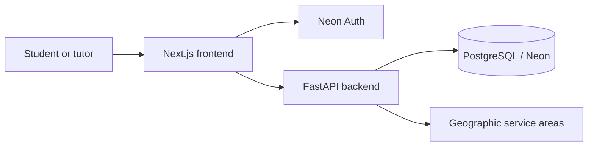

# tutorME

**A full-stack tutoring marketplace for finding tutors, managing availability, and coordinating sessions.**

[**Live application**](https://tutorme2.vercel.app/) · [**Engineering documentation**](docs/README.md) · [**Source code**](https://github.com/SayeGorgor/tutorME)

tutorME connects students with tutors for online and in-person learning. Students can discover tutors by subject and location, compare profiles and availability, and manage session requests. Tutors can maintain their profiles, subjects, and schedules through dedicated account workflows.

Built with **Next.js, TypeScript, FastAPI and PostgreSQL**, tutorME focuses on concurrent booking integrity, backend resource ownership, time-zone-aware scheduling and geographic discovery across independently deployed services.

> **Project status:** Actively developed. The live site demonstrates the application, but real booking availability depends on deployment configuration and policy readiness. Payments, automatic meeting creation, and calendar synchronization are not implemented. Not all development and integration tests have been validated against hosted production services.

## Features

| For students | For tutors |
| --- | --- |
| Discover tutors by subject, location, price, and session format | Create and manage a tutor profile |
| Browse profiles, offered subjects, and available times | Configure online and in-person offerings |
| Use authenticated student account workflows | Manage weekly and date-specific availability |
| Request and manage eligible tutoring sessions | Review and act on booking requests |

## Tech stack

| Layer | Technology |
| --- | --- |
| Frontend | Next.js 16, React, TypeScript, Tailwind CSS 4 |
| Backend | Python, FastAPI, Pydantic |
| Database | PostgreSQL (Neon), SQLAlchemy, Alembic |
| Authentication | Neon Auth, signed JWTs, application-level authorization |
| Location | Google Maps Platform, U.S. Census geographic data |
| Deployment | Vercel (frontend), Railway (backend) |

## Architecture



The Next.js application handles presentation, account navigation, and authenticated requests. The FastAPI service owns validation, authorization, tutor search, scheduling rules, and booking state changes. PostgreSQL stores application data, while Alembic tracks schema changes. Neon Auth manages identity and sessions; the API independently verifies authenticated requests and enforces ownership.

For more detail, see [architecture and API boundaries](docs/architecture.md).

## Engineering highlights

### Concurrency-safe booking logic

The booking service accounts for conflicts involving both participants. A confirmed session must not overlap another confirmed booking for the same tutor **or** student—even across different tutoring formats or tutors.

- Uses PostgreSQL transactions: locks participant User rows in ascending ID order, then the TutorProfile row, before rechecking and confirming requests.
- Checks overlapping time intervals and revalidates eligibility and availability within the transaction.
- Supports idempotent request retries and detects changed booking parameters.
- Preserves immutable subject and price snapshots through normal booking transitions.

Pending requests are **not** guaranteed reservations, and the concurrency rules depend on cooperating database writers. See [booking, scheduling, and concurrency](docs/booking-and-scheduling.md).

### Authentication and resource ownership

Neon Auth manages identity and sessions; FastAPI verifies EdDSA-signed JWTs with required expiration, issuer, audience and subject claims. Database-backed roles and ownership checks protect tutor profiles, availability and participant-only booking details. Public listings use separate response payloads. Hosted signup, token refresh and provider acceptance remain separate release checks.

See [authentication and authorization](docs/authentication-and-authorization.md).

### Time-zone-aware scheduling

Tutors can combine recurring weekly availability with date-specific schedules in IANA time zones. Appointments persist as UTC instants; validation rejects nonexistent or ambiguous local times at DST transitions. Availability is rechecked when confirming a booking.

See [booking and scheduling](docs/booking-and-scheduling.md).

### Geographic tutor discovery

Location search combines Google Places input with independently identified U.S. Census service areas. Matching uses stable geographic identifiers and bounded distance calculations rather than treating a display name as a unique location.

See [location integration](docs/location.md).

### Database evolution and testing

SQLAlchemy models and Alembic migrations define the data layer. GitHub Actions runs separate frontend, isolated backend and migrated PostgreSQL integration jobs. Tests cover registration, JWT verification, ownership, scheduling, idempotency and booking races.

The November 8, 2026 run passed backend and migrated PostgreSQL checks; frontend TypeScript validation failed, leaving lint and build unexecuted. See the dated evidence in the testing guide rather than assuming all jobs pass. SQLite tests do not prove PostgreSQL locking; integration tests use a guarded, job-owned disposable database.

See [testing and reliability](docs/testing.md) and [database design](docs/database.md).

## Repository structure

```text
tutorME/
|-- .github/workflows/     # GitHub Actions checks
|-- frontend/              # Next.js app, components, and frontend tests
|-- backend/
|   |-- app/               # FastAPI routes, services, models, and schemas
|   |-- alembic/           # Database migrations
|   |-- tests/             # Isolated and guarded Neon tests
|   |-- integration/       # Migrated PostgreSQL CI tests
|   |-- scripts/           # Guarded tooling and isolated test runner
|   `-- requirements.txt
`-- docs/                  # Engineering guides and technical deep dives
```

## Current scope and limitations

- Real bookings are subject to feature and policy gates; the presence of booking UI does not guarantee public booking is enabled.
- Session quotes are for direct arrangements; **the app does not process payments**.
- There is no automatic video-meeting provision, email notification service, calendar sync, or atomic rescheduling.
- Genuine minor-account booking flows are outside the currently implemented scope.
- Hosted authentication, provider integrations and target-specific migration readiness require separate release validation beyond CI.

## Documentation

Start with the [engineering documentation index](docs/README.md), or jump directly to [architecture](docs/architecture.md), [booking and scheduling](docs/booking-and-scheduling.md), [authentication](docs/authentication-and-authorization.md), [database design](docs/database.md), [location](docs/location.md), [deployment](docs/deployment.md), or [testing](docs/testing.md).

---

Built by [Saye Gorgor](https://github.com/SayeGorgor).
