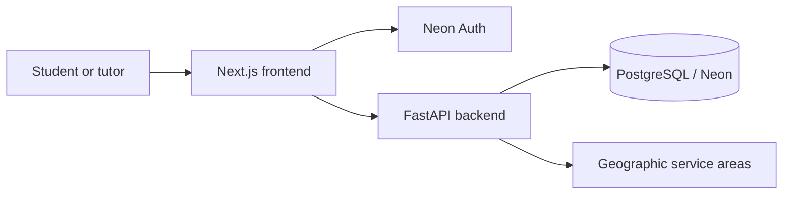

# tutorME

**A full-stack tutoring marketplace for finding tutors, managing availability, and coordinating sessions.**

[**Live application**](https://tutorme2.vercel.app/) · [**Engineering documentation**](docs/README.md) · [**Source code**](https://github.com/SayeGorgor/tutorME)

tutorME connects students with tutors for online and in-person learning. Students can discover tutors by subject and location, compare profiles and availability, and manage session requests. Tutors can maintain their profiles, subjects, and schedules through dedicated account workflows.

I built tutorME to explore the engineering challenges behind a real marketplace: reliable scheduling, concurrent bookings, authenticated user access, geographic discovery, and coordination between independently deployed frontend and backend services.

> **Project status:** Actively developed. The live site demonstrates the application, but real booking availability depends on deployment configuration and policy readiness. Payments, automatic meeting creation, and calendar synchronization are not implemented. Not all development and integration tests have been validated against hosted production services.

## Features

| For students | For tutors |
| --- | --- |
| Discover tutors by subject, location, price, and session format | Create and manage a tutor profile |
| Browse profiles, offered subjects, and available times | Configure online and in-person offerings |
| Use authenticated student account workflows | Manage weekly and date-specific availability |
| Request and manage eligible tutoring sessions | Review and act on booking requests |

Additional capabilities include:

- **Online and in-person discovery:** Google Places-assisted location selection with independent geographic service-area matching.
- **Time-zone-aware scheduling:** Recurring and date-specific availability, stored UTC appointment times, and daylight-saving-time validation.
- **Protected account workflows:** Neon Auth identity with backend-enforced student/tutor roles and resource ownership.
- **Responsive UI:** Layouts designed for desktop, tablet, and mobile browsing.

## Tech stack

| Layer | Technology |
| --- | --- |
| Frontend | Next.js 16, React, TypeScript, Tailwind CSS 4 |
| Backend | Python, FastAPI, Pydantic |
| Database | PostgreSQL (Neon), SQLAlchemy, Alembic |
| Authentication | Neon Auth, signed JWTs, application-level authorization |
| Location | Google Maps Platform, U.S. Census geographic data |
| Deployment | Vercel (frontend), Railway (backend) |

## Architecture



The Next.js application handles presentation, account navigation, and authenticated requests. The FastAPI service owns validation, authorization, tutor search, scheduling rules, and booking state changes. PostgreSQL stores application data, while Alembic tracks schema changes. Neon Auth manages identity and sessions; the API independently verifies authenticated requests and enforces ownership.

For more detail, see [architecture and API boundaries](docs/architecture.md).

## Engineering highlights

### Concurrency-safe booking logic

The booking service accounts for conflicts involving both participants. A confirmed session must not overlap another confirmed booking for the same tutor **or** student—even across different tutoring formats or tutors.

- Uses PostgreSQL transactions and a consistent participant/profile lock order when confirming requests.
- Checks overlapping time intervals and revalidates eligibility and availability within the transaction.
- Supports idempotent request retries and detects changed booking parameters.
- Preserves the quoted subject and price snapshot associated with a request.

Pending requests are **not** guaranteed reservations, and the concurrency rules depend on cooperating database writers. See [booking, scheduling, and concurrency](docs/booking-and-scheduling.md).

### Authentication and resource ownership

Authentication identifies the caller; authorization determines what that caller can do. Backend checks protect tutor profile changes, availability updates, and participant-specific booking information. Public tutor listings use separate response payloads from private booking details.

See [authentication and authorization](docs/authentication-and-authorization.md).

### Geographic tutor discovery

Location search combines Google Places input with independently identified U.S. Census service areas. Matching uses stable geographic identifiers and bounded distance calculations rather than treating a display name as a unique location.

See [location integration](docs/location.md).

### Database evolution and testing

SQLAlchemy models represent application records, and Alembic revisions manage schema changes. The test suite covers registration, authorization, scheduling, conflicts, and booking behavior. PostgreSQL concurrency tests have additional safeguards and require an explicitly approved disposable database; SQLite-based unit tests do not prove real PostgreSQL locking behavior.

See [testing and reliability](docs/testing.md) and [database design](docs/database.md).

## Repository structure

```text
tutorME/
├── frontend/              # Next.js app, components, and frontend tests
├── backend/
│   ├── app/               # FastAPI routes, services, models, and schemas
│   ├── alembic/           # Database migrations
│   ├── tests/             # Backend and guarded integration tests
│   └── requirements.txt
└── docs/                  # Architecture, security, scheduling, and test guides
```

## Running locally

**Prerequisites:** Node.js and npm, a compatible Python environment, PostgreSQL, and development-only credentials for the external services you choose to enable.

**Frontend**

```bash
cd frontend
npm ci
npm run dev
```

**Backend** (from a separate terminal, after creating and activating a Python virtual environment)

```bash
cd backend
python -m pip install -r requirements.txt
python -m uvicorn app.main:app --reload
```

The applications require environment-specific configuration. Consult [deployment and environment configuration](docs/deployment.md) for variable names and service boundaries. Keep credentials in ignored local environment files or a secret manager; do not commit them. Configure database access and review Alembic migrations independently before enabling state-changing workflows. Never use a production database for local or automated tests.

For frontend checks, `npm run lint` and `npm run build` are available. Backend and integration test requirements are described in [the testing guide](docs/testing.md).

## Current scope and limitations

- Real bookings are subject to feature and policy gates; the presence of booking UI does not guarantee public booking is enabled.
- Session quotes are for direct arrangements; **the app does not process payments**.
- There is no automatic video-meeting provision, email notification service, calendar sync, or atomic rescheduling.
- Genuine minor-account booking flows are outside the currently implemented scope.
- Hosted authentication, provider integrations, and database migrations require separate release validation beyond isolated tests.

## Documentation

Start with the [engineering documentation index](docs/README.md), or jump directly to [architecture](docs/architecture.md), [booking and scheduling](docs/booking-and-scheduling.md), [authentication](docs/authentication-and-authorization.md), [database design](docs/database.md), [location](docs/location.md), [deployment](docs/deployment.md), or [testing](docs/testing.md).

---

Built by [Saye Gorgor](https://github.com/SayeGorgor).

